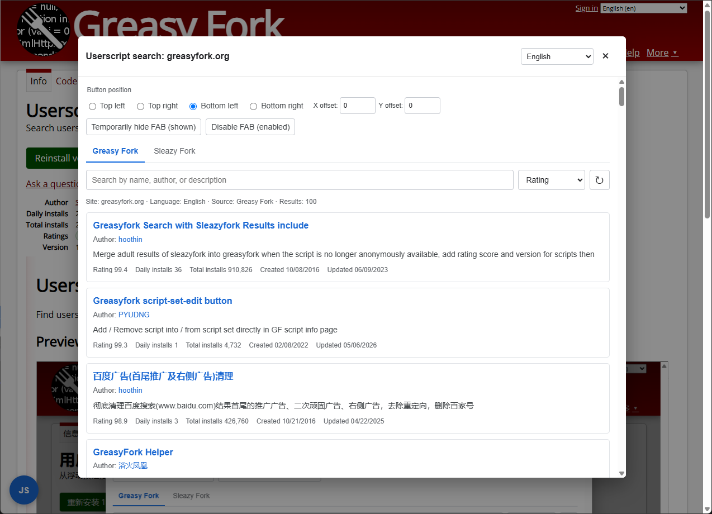

# Userscript Search

Find userscripts for the current website from any page.

## Preview

## Features

- Search Greasy Fork and Sleazy Fork.
- Detect the current website automatically, with parent-domain selection when needed.
- Search by name, author, or description and sort by several metrics.
- View ratings, install counts, creation time, update time, and descriptions.
- Load more results, refresh the list, and return to the top.
- Open a script or author page by clicking its name.
- Supports Simplified Chinese, Traditional Chinese, English, and Japanese.

## Usage

1. Install the script and open any website.
2. Click the `JS` button in the corner of the page.
3. Choose a language, search domain, and data source.
4. Search for a script and open it.

## FAB Settings

The top of the window lets you configure:

- Button corner.
- X/Y offset.
- Temporary button visibility.
- Persistent FAB visibility.

The userscript menu also provides commands to:

- Enable or disable the FAB.
- Open the userscript search dialog.

