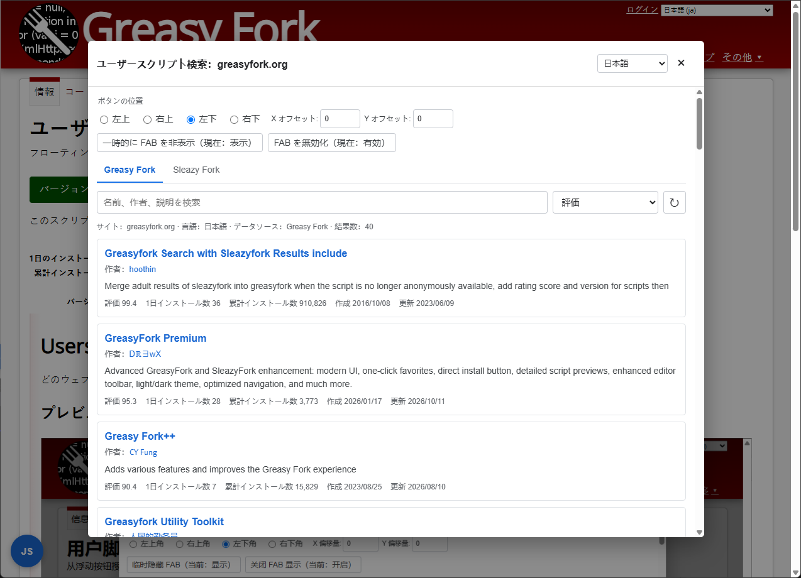

# Userscript Search

どのウェブサイトからでも、現在のサイトで使えるユーザースクリプトを検索できます。

## プレビュー

## 機能

- Greasy Fork と Sleazy Fork に対応。
- 現在のサイトを自動検出し、必要に応じて親ドメインも選択可能。
- 名前、作者、説明で検索し、複数の指標で並べ替え。
- 評価、インストール数、作成日、更新日、説明を表示。
- 追加読み込み、更新、ページ上部への移動に対応。
- スクリプト名または作者名から各ページを開けます。
- 簡体字中国語、繁体字中国語、English、日本語に対応。

## 使い方

1. スクリプトをインストールして、任意のウェブサイトを開きます。
2. ページの隅にある `JS` ボタンをクリックします。
3. 言語、検索ドメイン、データソースを選択します。
4. スクリプトを検索して開きます。

## FAB 設定

ウィンドウ上部で次の項目を設定できます。

- ボタンの位置。
- X/Y オフセット。
- 一時的な表示・非表示。
- FAB 表示状態の保存。

ユーザースクリプトメニューからも次の操作ができます。

- FAB の有効・無効を切り替える。
- ユーザースクリプト検索を開く。

