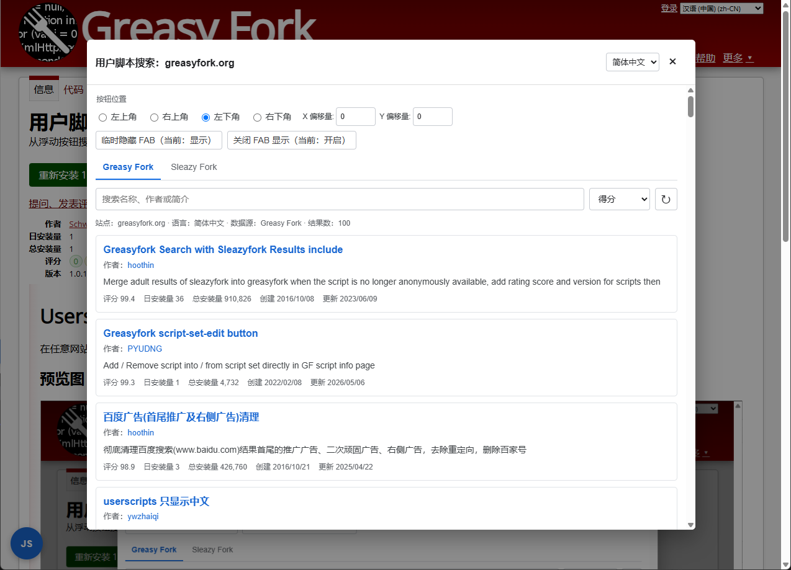

# Userscript Search

在任意网站快速查找适用于当前网站的用户脚本。

## 预览图

## 功能

- 支持 Greasy Fork 和 Sleazy Fork。
- 自动根据当前网站域名查找脚本，也支持选择父级域名。
- 可按名称、作者或简介搜索，并按多种指标排序。
- 显示评分、安装量、创建时间、更新时间和简介。
- 支持分页加载、刷新和回到顶部。
- 点击脚本名称或作者即可打开对应页面。
- 支持简体中文、繁體中文、English 和日本語。

## 使用方法

1. 安装脚本后打开任意网站页面。
2. 点击页面角落的 `JS` 按钮。
3. 选择语言、搜索域名和数据源。
4. 搜索并打开需要的脚本。

## FAB 设置

在窗口顶部可以设置：

- 按钮所在角落。
- X/Y 偏移量。
- 临时显示或隐藏按钮。
- 持久开启或关闭按钮显示。

油猴菜单提供以下入口：

- 开启或关闭 FAB 显示。
- 打开脚本搜索弹窗。

