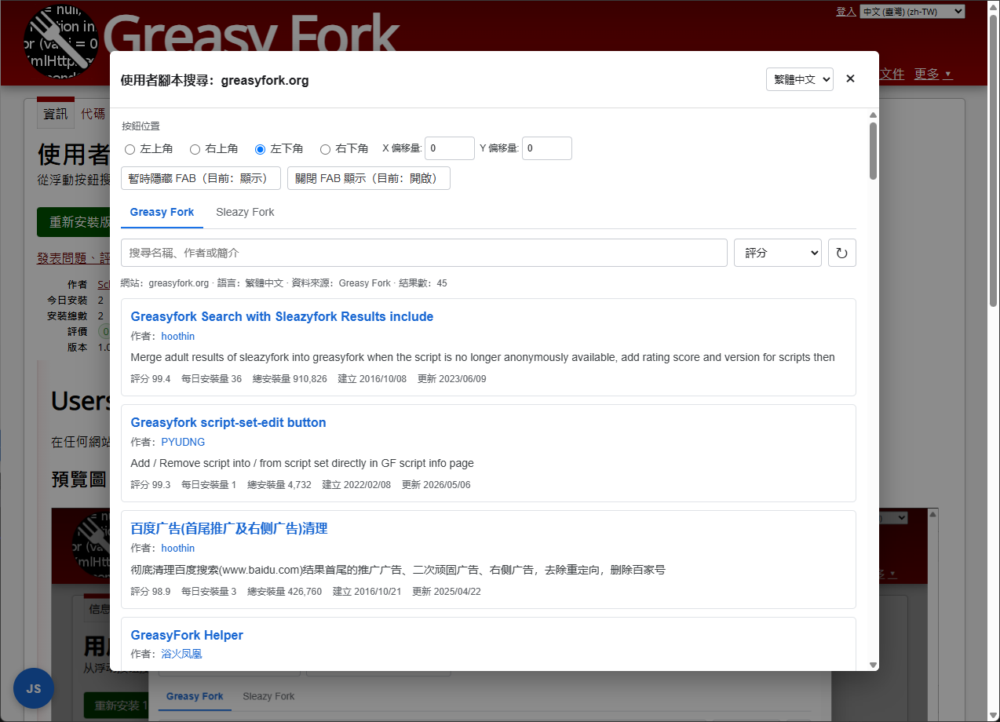

# Userscript Search

在任何網站快速尋找適用於目前網站的使用者腳本。

## 預覽圖

## 功能

- 支援 Greasy Fork 和 Sleazy Fork。
- 依目前網站網域自動尋找腳本，也可選擇父層網域。
- 可依名稱、作者或簡介搜尋，並依多種指標排序。
- 顯示評分、安裝量、建立時間、更新時間和簡介。
- 支援分頁載入、重新整理和回到頂部。
- 點擊腳本名稱或作者即可開啟對應頁面。
- 支援簡體中文、繁體中文、English 和日本語。

## 使用方法

1. 安裝腳本後開啟任意網站。
2. 點擊頁面角落的 `JS` 按鈕。
3. 選擇語言、搜尋網域和資料來源。
4. 搜尋並開啟需要的腳本。

## FAB 設定

在視窗頂部可以設定：

- 按鈕所在角落。
- X/Y 偏移量。
- 暫時顯示或隱藏按鈕。
- 持久開啟或關閉按鈕顯示。

油猴選單提供以下入口：

- 開啟或關閉 FAB 顯示。
- 開啟使用者腳本搜尋視窗。

